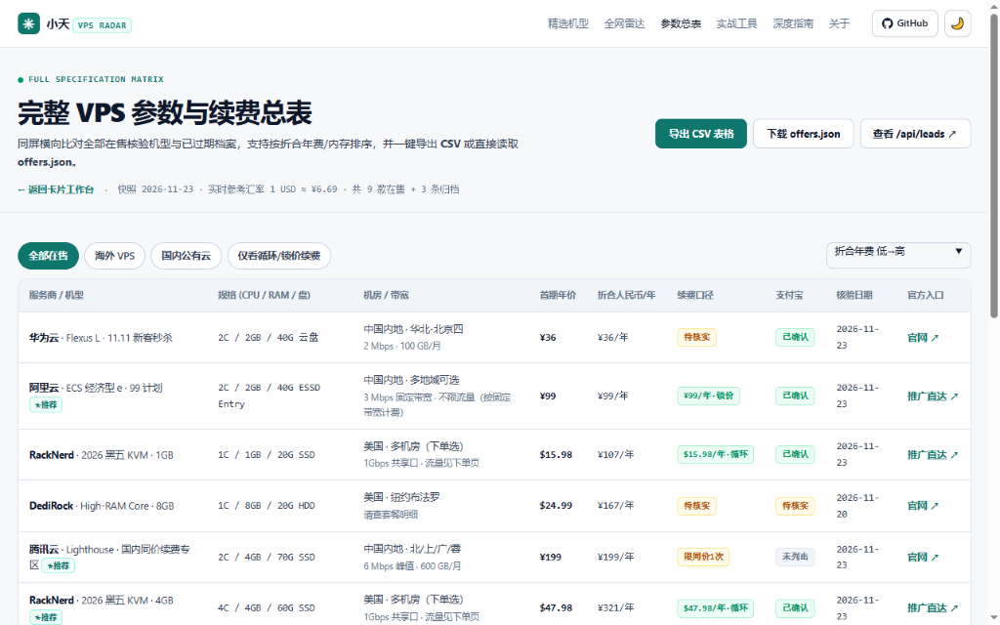
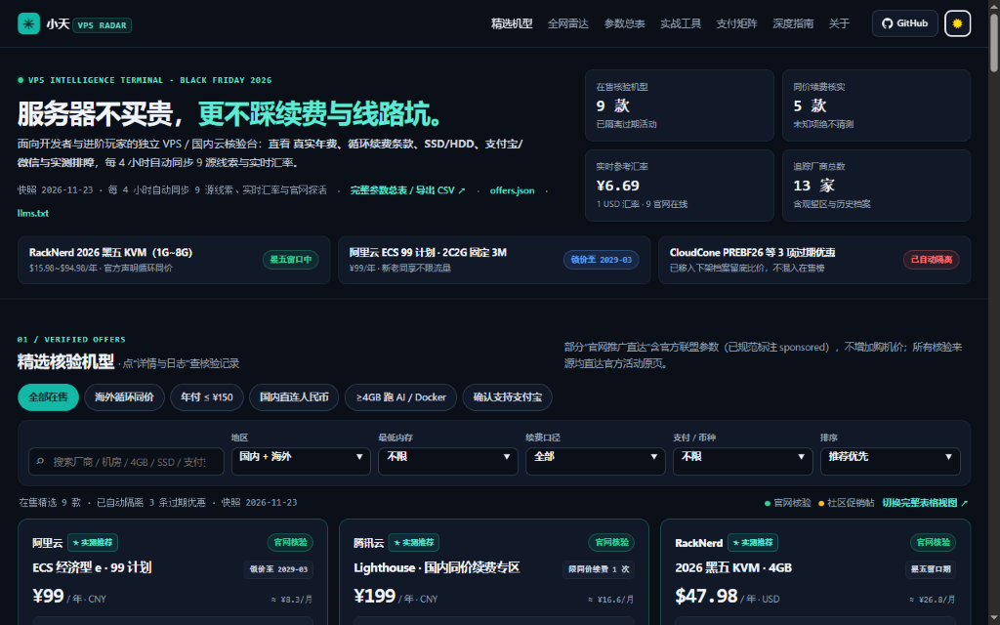
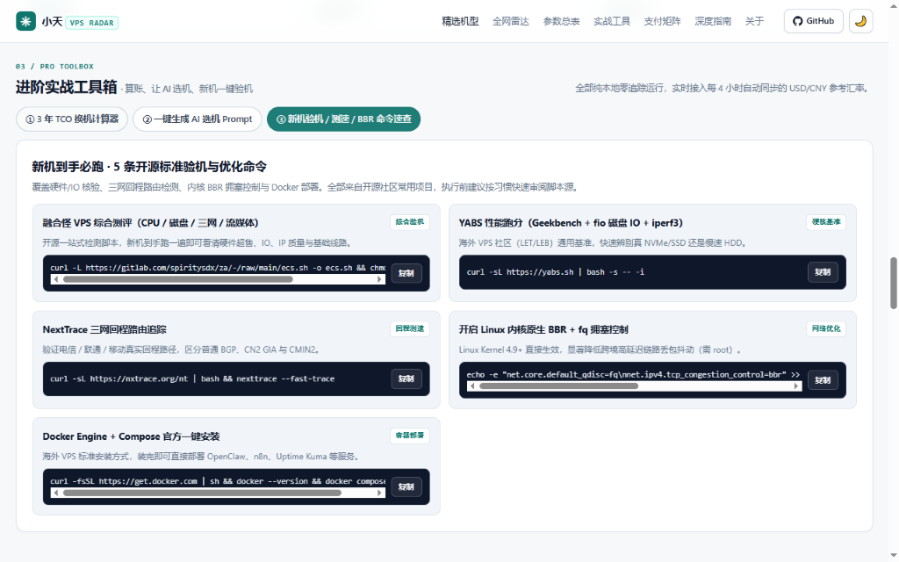

# 小天 VPS 雷达 (`xiaotian-vps-radar`)

<p align="center">
  <strong>面向开发者与进阶玩家的开源 VPS / 国内云续费核验台 · 全自动 4H AI 情报雷达 · $0/月运行在 Cloudflare Workers</strong>
</p>

<p align="center">
  <a href="https://vps.xiaotianai.win/"><b>🌐 在线演示 Live Demo</b></a> ·
  <a href="https://vps.xiaotianai.win/table.html">📊 完整参数总表</a> ·
  <a href="https://vps.xiaotianai.win/api/leads">📡 4H 实时 JSON API</a> ·
  <a href="https://github.com/fightlife228/xiaotian-vps-radar/issues/new/choose">📮 提交优惠 / 报失效</a>
</p>

<p align="center">
  
  
  
  
</p>

---

## 为什么做这个项目？

买 VPS / 云服务器最容易踩的 3 个坑：
1. **只看首年低价，忽略次年原价续费**（把“首年秒杀”当“循环同价”算账）
2. **只看大内存噱头，忽略 1 vCPU + HDD 机械慢盘、月流量上限与国内备案要求**
3. **满网过期货与英文黑五帖**（LowEndTalk / LowEndBox 信息碎片化、过期的折扣码还在被到处转发）

**`xiaotian-vps-radar`** 用一套**零前端构建依赖、零服务器月费（Cloudflare Free Tier）**的极简架构，把「人工核验三态档案 + 每 4 小时全自动 9 源 AI 情报雷达 + 进阶开发者工具箱」整合在一起。

---

## 界面预览（V2.0 工程双主题）

### 1. 完整参数与续费总表（默认工程亮色风 + 实时汇率折算 + 导出 CSV/JSON）


### 2. 首页工作台（支持一键切换 Linear 风格专业暗黑 + 3 列规格卡 + 详情核验抽屉）


### 3. 进阶实战工具箱（3 年 TCO 换机计算器 + AI 选机 Prompt 生成器 + 5 条新机一键验机命令）


---

## 核心特性

| 模块 | 说明 |
|---|---|
| **瑞士工程双主题 UI** | 默认高可读冷白灰工程亮色风，右上角一键切换 Linear/Vercel 风格专业暗黑，无闪烁 `localStorage` 持久化 |
| **三态情报生命周期** | **在售精选**（带 `★实测推荐`、循环续费强标、详情变更日志抽屉）· **观望区**（标复核日）· **已过期/下架档案**（隔离过期货） |
| **4H 自动 9 源雷达 + 免费 Workers AI** | Cloudflare Workers Cron 每 4 小时抓取 LowEndBox / LowEndTalk / LowEndSpirit / RackNerd / 老左 / VPSGO 等 9 大公开 RSS，调用免费 Workers AI 增量翻译中文并生成 4H 速读简报（14 天 KV 增量缓存） |
| **自动汇率同步 + 官网在线探活** | 每 4 小时自动同步 USD/CNY 实时参考汇率，并自动 HEAD 巡检各厂商活动页在线状态（`● 官网在线 ✓`） |
| **零 JS 友好的 SEO + GEO** | Worker 直接将最新 AI 中文简报与 Top 12 线索 SSR 注入首页 HTML；提供 `/table.html` 静态总表、`llms.txt`、`sitemap.xml` 与可选 IndexNow 自动推送 |
| **进阶实战工具箱** | ① 3 年 TCO 换机省钱计算器 · ② 一键生成带实时快照的 AI 选机 Prompt · ③ 新机到手 5 条标准开源命令速查（融合怪 `ecs.sh` / YABS / NextTrace / BBR / Docker）· ④ 12 家厂商支付与币种矩阵 |

---

## 零成本架构（Cloudflare Free Tier）

```text
  Cloudflare Cron (0 */4 * * *)
        │
        ├──► 9 Public RSS Feeds ──► Workers AI (Qwen2.5 / Llama3.3) ──► KV (dynamic:leads + ai_cache)
        └──► FX API + 9 Provider HEAD Probes ─────────────────────────► KV (dynamic:live_status)
                                                                              │
  Browser / Search Bot / AI Agent ──► Cloudflare Worker (worker.js) ◄─────────┘
        ├── GET /                (HTML + SSR AI Brief & Leads)
        ├── GET /table.html      (Full Spec Matrix + CSV/JSON Export)
        ├── GET /data/offers.json
        ├── GET /api/leads       (CORS JSON)
        └── GET /api/live-status (CORS JSON)
```

---

## 5 分钟免费部署你自己的实例

### 1. 克隆仓库并登录 Cloudflare
```bash
git clone https://github.com/fightlife228/xiaotian-vps-radar.git
cd xiaotian-vps-radar
npx wrangler login
```

### 2. 创建 KV 命名空间并准备配置
```bash
npx wrangler kv namespace create SITE_KV
cp wrangler.example.jsonc wrangler.jsonc
```
编辑 `wrangler.jsonc`，将上一步生成的 KV Namespace ID 填入 `id`，并将 `vps.yourdomain.com` 改成你的自定义域名（也可注释 `routes` 先使用 `*.workers.dev`）。

### 3. 上传静态页面与数据到 KV
```bash
node scripts/upload_kv.mjs --namespace-id <你的_KV_NAMESPACE_ID>
```

### 4. 部署 Worker（自动开启每 4 小时 Cron 与 Workers AI）
```bash
npx wrangler deploy
```
部署完成后访问 `/api/leads` 和 `/api/live-status` 即可触发首次采集与 AI 翻译缓存！

---

## 开放数据接口（支持直接使用或喂给 AI Agent）

- **结构化核验机型 + 观望区 + 过期档案**：`https://vps.xiaotianai.win/data/offers.json`
- **每 4 小时 9 源实时线索 + AI 中文简报**：`https://vps.xiaotianai.win/api/leads`
- **每 4 小时实时汇率 + 官网在线探活**：`https://vps.xiaotianai.win/api/live-status`
- **AI / Agent 站点索引**：`https://vps.xiaotianai.win/llms.txt`

> **透明说明**：本开源仓库 `data/offers.json` 全部使用**纯官方无推广链接**；如需在自建实例中接入官方推广链接，只需在对应机型上设置 `"sponsored": true` 并在页面保留合规披露。

---

## 参与贡献 & 社区纠错

发现任何套餐涨价、无货、优惠码过期，或想补充高性价比循环同价 VPS？
- 👉 **[提交新优惠](https://github.com/fightlife228/xiaotian-vps-radar/issues/new?template=submit-deal.md)**
- 👉 **[报失效 / 价格纠错](https://github.com/fightlife228/xiaotian-vps-radar/issues/new?template=report-expired.md)**
- 或者直接 Fork 修改 `data/offers.json` 提交 Pull Request！

如果这个开源项目帮你避开了续费坑或省下了自建情报站的开发时间，欢迎点个 **⭐ Star** 支持！

---

## License

[MIT License](./LICENSE) © 2026 [小天聊AI](https://www.xiaotianai.win/)
